# Comprehensive Guide: Intelligent Student Performance Prediction & Intervention Suite

This document provides a deep, production-grade technical breakdown of the **8 Advanced Student Performance Prediction & Pedagogical Intervention Systems** implemented in this platform. It covers mathematical formulations, architectural diagrams, algorithmic logic, UI integration touchpoints, REST APIs, and automated verification protocols.

---

## 📑 Table of Contents
1. [Architectural Overview & Data Flow](#1-architectural-overview--data-flow)
2. [Module 1: Subject-Level Backlog & Grade Risk Predictor](#2-module-1-subject-level-backlog--grade-risk-predictor)
3. [Module 2: Probabilistic Forecasting & Confidence Intervals (Uncertainty Quantification)](#3-module-2-probabilistic-forecasting--confidence-intervals-uncertainty-quantification)
4. [Module 3: Prescriptive Counterfactual Engine ("Minimum Effort Solver")](#4-module-3-prescriptive-counterfactual-engine-minimum-effort-solver)
5. [Module 4: Dynamic Early Warning System (EWS) & Rescue Window Timeline](#5-module-4-dynamic-early-warning-system-ews--rescue-window-timeline)
6. [Module 5: Prerequisite Knowledge-Graph / Dependency Vulnerability Analysis](#6-module-5-prerequisite-knowledge-graph--dependency-vulnerability-analysis)
7. [Module 6: Unsupervised Student Persona / Archetype Clustering](#7-module-6-unsupervised-student-persona--archetype-clustering)
8. [Module 7: Multi-Pathway Career Predictor (Beyond Campus Placements)](#8-module-7-multi-pathway-career-predictor-beyond-campus-placements)
9. [Module 8: Faculty Early-Intervention Cohort Matrix & Action Hub](#9-module-8-faculty-early-intervention-cohort-matrix--action-hub)
10. [REST API Endpoint Reference](#10-rest-api-endpoint-reference)
11. [Automated Verification & Test Report](#11-automated-verification--test-report)

---

## 1. Architectural Overview & Data Flow

The system transitions traditional academic reporting from **passive descriptive analytics** into **active, prescriptive, and explainable decision support**.

```mermaid
flowchart TD
    subgraph Input_Data ["Raw Academic & Behavioral Telemetry"]
        A1["Academic Records (Sem 1-4 Audited Marks)"]
        A2["Ongoing Semester 5 Internals (TT1, TT2, Continuous)"]
        A3["Real-Time Classroom Attendance Records"]
        A4["Curriculum Prerequisite Graph (DAG)"]
    end

    subgraph Analytics_Engine ["ml_engine/ Intelligence Core"]
        M1["1. Subject Risk & Backlog Engine<br><i>subject_risk.py</i>"]
        M2["2. Uncertainty & Confidence Bounds<br><i>inference.py</i>"]
        M3["3. Counterfactual Pathways Solver<br><i>counterfactuals.py</i>"]
        M4["4. Dynamic EWS & Rescue Window<br><i>early_warning.py</i>"]
        M5["5. Knowledge-Graph DAG Analyzer<br><i>knowledge_graph.py</i>"]
        M6["6. Persona Archetype Profiler<br><i>persona_engine.py</i>"]
        M7["7. Multi-Track Career Forecaster<br><i>career_pathways.py</i>"]
    end

    subgraph Data_Storage ["Persistent Layer (MongoDB & Redis Cache)"]
        D1[("users")]
        D2[("academic_records")]
        D3[("predictions_cache")]
        D4[("interventions")]
    end

    subgraph Portals ["User Experience & Action Interfaces"]
        P1["Student Portal: Personalized Dashboard, Career Gauges, Scenario Pills"]
        P2["Faculty Portal: 2x2 Risk Quadrant, 1-Click Remedial Dispatch Hub"]
        P3["Public API: Swagger REST Endpoints"]
    end

    Input_Data --> Analytics_Engine
    Analytics_Engine --> Data_Storage
    Data_Storage --> Portals
```



---

## 2. Module 1: Subject-Level Backlog & Grade Risk Predictor
- **Source Code**: [`ml_engine/subject_risk.py`](file:///c:/Users/risha/Desktop/Sem%20project/ml_engine/subject_risk.py)
- **Primary Method**: `compute_subject_risk_profile()`, `analyze_all_enrolled_subjects()`

### Technical Problem
Standard academic models only predict a single aggregated semester SGPA. However, a student with a projected 7.8 SGPA can still fail a single critical course (e.g., *Design and Analysis of Algorithms*), resulting in a Backlog/KT (Kept to Term) that disqualifies them from campus placement drives.

### Mathematical Formulation
1. **Continuous Internal Evaluation ($I_c$)**:
   Out of 40 maximum marks:
   $$I_c = \text{TT}_{\text{converted}} + \text{Aptitude} + \text{SKAT} + \text{Teacher Assessment} + \text{Mock Interview} + \text{Presentation}$$
   $$\text{where } \text{TT}_{\text{converted}} = \frac{\text{TT}_1 + \text{TT}_2}{4.0} \quad (\text{scaled to } 10.0)$$

2. **Course Difficulty Factor ($D_c$)**:
   Calibrated using historical cohort variances and failure rates:
   $$D_{\text{DAA}} = 1.25, \quad D_{\text{ML-II}} = 1.20, \quad D_{\text{EM}} = 1.25, \quad D_{\text{IS}} = 1.15, \quad D_{\text{CCN}} = 1.10$$

3. **Projected End Semester Exam ($ESE_{\text{proj}}$ out of 60)**:
   $$ESE_{\text{proj}} = \min\left(60.0, \max\left(0.0, \frac{I_c}{40.0} \cdot 60.0 \cdot \frac{1}{\sqrt{D_c}} + (A_c - 75.0) \cdot 0.05\right)\right)$$
   $$T_c = I_c + ESE_{\text{proj}}$$

4. **Backlog / KT Risk Probability ($P(\text{KT})$)**:
   Modelled via a calibrated sigmoid logit based on internal deficit, attendance deficit, and subject difficulty:
   $$\text{Deficit} = (22.0 - I_c) \cdot 0.25 + (75.0 - A_c) \cdot 0.04$$
   $$\text{Logit } z = (\text{Deficit} \cdot D_c) - 0.8$$
   $$P(\text{KT}) = \frac{1}{1 + e^{-z}}$$

5. **Minimum Required Exam Thresholds**:
   - **Minimum to Pass ($P$)**: University mandates min 40% overall AND min 24/60 in written ESE:
     $$ESE_{\text{pass}} = \max(24.0, \lceil 40.0 - I_c \rceil)$$
   - **Minimum for Grade $A$ ($\ge 70$)**:
     $$ESE_{\text{Grade } A} = \max(ESE_{\text{pass}}, \lceil 70.0 - I_c \rceil)$$

### UI Integration
Integrated directly into the **Subject Competency Matrix** on the Student Dashboard (`student_dashboard.html`), replacing static grades with dynamic projected grades, backlog risk badges, and exact End-Semester Exam targets.

---

## 3. Module 2: Probabilistic Forecasting & Confidence Intervals (Uncertainty Quantification)
- **Source Code**: [`ml_engine/inference.py`](file:///c:/Users/risha/Desktop/Sem%20project/ml_engine/inference.py)
- **Primary Output**: `predicted_sgpa_min`, `predicted_sgpa_max`, `margin_of_error`, `scenario_projections`

### Technical Problem
Deterministic point estimates (e.g. `Predicted SGPA = 8.21`) give false precision. Student performance has natural variance driven by paper difficulty, exam stress, and attendance fluctuations.

### Mathematical Formulation
1. **Dynamic Uncertainty Scaling ($\sigma_u$)**:
   $$\sigma_u = \begin{cases} 
   \max(0.18, \min(0.60, \text{std}(SGPA_{1..k}) \cdot 0.85)) & \text{if } k \ge 2 \\
   0.50 & \text{if Cold Start (Sem 1)} \\
   0.32 & \text{otherwise}
   \end{cases}$$
   $$\text{If Attendance } < 75.0\% \implies \sigma_u \leftarrow \sigma_u + 0.10$$

2. **90% Confidence Interval (Z-score $z_{0.90} = 1.645$)**:
   $$\text{Margin of Error } \delta = 1.645 \cdot \sigma_u$$
   $$SGPA_{\min} = \max(4.0, \hat{y} - \delta), \quad SGPA_{\max} = \min(10.0, \hat{y} + \delta)$$

3. **3-Scenario Analysis**:
   - **Pessimistic Scenario**: Lower bound ($SGPA_{\min}$) representing exam shocks or attendance dips.
   - **Expected Scenario**: Point estimate ($\hat{y}$) representing baseline regression pace.
   - **Optimistic Scenario**: Upper bound ($SGPA_{\max}$) representing top-quartile Unit Test 2 & ESE performance.

---

## 4. Module 3: Prescriptive Counterfactual Engine ("Minimum Effort Solver")
- **Source Code**: [`ml_engine/counterfactuals.py`](file:///c:/Users/risha/Desktop/Sem%20project/ml_engine/counterfactuals.py)
- **Primary Method**: `generate_counterfactual_pathways()`

### Technical Problem
Standard Explainable AI (SHAP) explains *why* a prediction was made, but does not tell the student *how to change it* with minimal friction.

### Mathematical Formulation
Given a target SGPA or cumulative CGPA $y^*$, the solver minimizes the multi-attribute effort function:
$$\min_{\Delta \vec{x}} \quad \mathcal{L}(\Delta \vec{x}) = w_1 (\Delta \text{TT}_2)^2 + w_2 (\Delta \text{Att})^2 + w_3 (\Delta \text{ESE})^2 \quad \text{subject to} \quad \widehat{SGPA}(\vec{x} + \Delta \vec{x}) \ge y^*$$

The engine generates **3 distinct pathways**:
1. **Balanced Progression Strategy**:
   - Distributes required effort equally across upcoming Unit Test 2, moderate attendance gains (+3 to +5 lectures), and ESE preparation.
   - Highest feasibility score ($\approx 85 - 95\%$).
2. **Exam Blitz Strategy (Zero Attendance Overtime)**:
   - Sets $\Delta \text{Att} = 0$. Useful for students unable to attend extra lectures due to medical or commute constraints.
   - Shifts 100% of effort into written ESE mastery (demanding 48–54/60 marks).
3. **Attendance Cushion & Internal Shield**:
   - Maximizes attendance ($\ge 85\%$) and continuous internal assessments to build a protective buffer, lowering the required ESE passing mark by 4–8 marks.

---

## 5. Module 4: Dynamic Early Warning System (EWS) & Rescue Window Timeline
- **Source Code**: [`ml_engine/early_warning.py`](file:///c:/Users/risha/Desktop/Sem%20project/ml_engine/early_warning.py)
- **Primary Method**: `evaluate_early_warning_system()`

### Technical Problem
Academic interventions typically happen too late (after final exam results). Students need continuous intra-semester telemetry showing their exact temporal window of opportunity.

### Mathematical Formulation
1. **Intra-Semester Phase Detection**:
   - `Phase 1`: Weeks 1–4 (Attendance baseline).
   - `Phase 2`: Weeks 5–8 (Post-Unit Test 1 diagnostic).
   - `Phase 3`: Weeks 9–12 (Post-Unit Test 2 & internal consolidation).
   - `Phase 4`: Weeks 13–16 (Pre-ESE Final Exam phase).

2. **Trajectory Classification**:
   - `CRITICAL_DEFICIT`: Attendance $<75\%$ AND internal marks $<14/40$ or active backlogs.
   - `DIVERGING_DOWNWARD`: Attendance $<75\%$ OR test divergence $<-15\%$ OR trend slope $<-0.30$.
   - `ACCELERATING`: Test divergence $>+10\%$ OR trend slope $>+0.25$.
   - `STABLE`: Tracking expected baseline within $\pm 5\%$.

3. **Rescue Window & Mathematical Ceiling**:
   - Computes exact days remaining: $\text{Days} = (\text{Total Weeks} - \text{Current Week}) \times 7$.
   - Calculates **Ceiling SGPA**: Theoretical maximum attainable SGPA if student achieves 100% on all remaining deliverables (TT2, Lab Journals, ESE).

---

## 6. Module 5: Prerequisite Knowledge-Graph / Dependency Vulnerability Analysis
- **Source Code**: [`ml_engine/knowledge_graph.py`](file:///c:/Users/risha/Desktop/Sem%20project/ml_engine/knowledge_graph.py)
- **Primary Method**: `analyze_prerequisite_knowledge_graph()`

### Technical Problem
Curricula are not isolated silos; they form a **Directed Acyclic Graph (DAG)**. Stumbling in a foundational course (e.g. *Data Structures*) creates cascading hidden vulnerabilities in advanced courses (e.g. *Algorithms*, *Machine Learning*).

### Knowledge Graph Architecture
```text
[CS101: Programming in C] --------> [CS201: Data Structures] ---------> [CS301: DAA]
[MA101/201: Engg Maths I/II] -----> [MA301: Engg Maths III] ---------> [DS401: ML-I] ------> [DS501: ML-II]
[CS302: Operating Systems] -------> [CS502: Cloud Computing]
[CS402: Computer Networks] -------> [CS503: Information Security]
```

### Mathematical Formulation
For each active course $c$, let $\text{Prereq}(c) = \{(p_i, w_i)\}$ be its prerequisite courses and weights:
$$\text{Deficit}(p_i) = \max(0.0, 7.0 - \text{GradePoint}(p_i))$$
$$\text{PVI}_c = \max_{p_i} \left( \frac{\text{Deficit}(p_i)}{7.0} \cdot w_i \cdot 100 \right)$$
- If $\text{PVI}_c \ge 40.0\% \implies \text{Severity: HIGH}$
- If $\text{PVI}_c \ge 20.0\% \implies \text{Severity: MODERATE}$

The engine automatically recommends **Curated Bridge Remedial Modules** (e.g., *Linear Algebra & Probability Foundations for ML*, *Graph Traversals & Dynamic Programming Bridge*).

---

## 7. Module 6: Unsupervised Student Persona / Archetype Clustering
- **Source Code**: [`ml_engine/persona_engine.py`](file:///c:/Users/risha/Desktop/Sem%20project/ml_engine/persona_engine.py)
- **Primary Method**: `classify_student_persona()`

### Technical Problem
Students have fundamentally different learning behaviors. A single generic suggestion like *"study harder"* fails to address their specific cognitive and behavioral traits.

### Trait Vector Formulation
A 5-dimensional feature space $\vec{v} \in [0, 100]^5$:
1. **Discipline & Attendance**: $\text{Attendance Percentage}$.
2. **Continuous Internal Mastery**: Normalized internal test score $\frac{\text{TT}_{\text{avg}}}{20.0} \times 100$.
3. **Exam Clutch Factor**: Ratio of historical End-Semester Exam scores to internal assessments.
4. **Practical & Technical Aptitude**: Laboratory, project presentation, and technical marks.
5. **Momentum & Academic Resilience**: Baseline adjusted by trend slope and backlog recovery:
   $$\text{Resilience} = 65.0 + (\text{Trend Slope} \cdot 40.0) - (\text{Backlogs} \cdot 18.0)$$

### Pedagogical Archetypes
| Archetype | Trait Profile | Diagnostic Behavior | Prescribed Strategy |
|---|---|---|---|
| **The Consistent High-Achiever** | High discipline, high internals, low variance | Methodical, structured, dependable | Challenge with international hackathons, open-source maintainership, and IEEE research papers. |
| **The End-Semester Sprinter** | Moderate attendance (75-80%), high ESE clutch | Coasts through early internals, relies on late cramming | Lock down TT2 internals to effortlessly boost cumulative CGPA by +0.5 without extra exam stress. |
| **The Practical Specialist** | High lab/project scores, lower written scores | Hands-on coder; struggles with formal rote exam answers | Drill structured written answer blueprints and diagram formats using Previous Year Question (PYQ) drill sheets. |
| **The Vulnerable Slider** | Downward trend ($<-0.25$), backlogs, attendance $<75\%$ | Disengaging or suffering conceptual burnout | Mandatory weekly faculty mentoring, daily zero-bunk mandate, and structured study milestones. |

---

## 8. Module 7: Multi-Pathway Career Predictor (Beyond Campus Placements)
- **Source Code**: [`ml_engine/career_pathways.py`](file:///c:/Users/risha/Desktop/Sem%20project/ml_engine/career_pathways.py)
- **Primary Method**: `evaluate_multi_pathway_careers()`

### Technical Problem
Most university systems only evaluate students for generic campus IT mass recruitment. Many students target higher studies, research, civil services, public sector undertakings (PSUs), or techno-management.

### 4 Post-Graduation Career Tracks
1. **Software Product & Tech Core (SWE/SDE)**:
   - Weights: Core CS ($40\%$), CGPA ($30\%$), Aptitude ($10\%$), Backlog penalty ($-15$ per backlog).
   - Milestone: 150+ LeetCode Mediums across Trees/Graphs/DP, Dockerized portfolio project.
2. **Higher Studies & Global Research (MS / PhD / GRE)**:
   - Weights: CGPA ($45\%$), Mathematics & Statistics ($35\%$), Research potential ($20\%$).
   - Milestone: Faculty collaboration on an IEEE/Springer conference paper, GRE/IELTS prep.
3. **Public Sector & Competitive Exams (GATE / PSU / IES)**:
   - Weights: Core CS breadth ($45\%$), Engineering Mathematics ($35\%$), Consistency ($20\%$).
   - Milestone: Topic-wise 15-year GATE PYQs, target All India Rank (AIR) $< 500$.
4. **Techno-Management & Consulting (MBA / Product Management)**:
   - Weights: Presentation & Communication ($35\%$), Aptitude ($30\%$), CGPA ($25\%$), Attendance ($10\%$).
   - Milestone: Quantitative aptitude & Data Interpretation speed drills for CAT/GMAT, leadership roles.

---

## 9. Module 8: Faculty Early-Intervention Cohort Matrix & Action Hub
- **Source Code**: [`routes/faculty_routes.py`](file:///c:/Users/risha/Desktop/Sem%20project/routes/faculty_routes.py) & [`templates/faculty/faculty_dashboard.html`](file:///c:/Users/risha/Desktop/Sem%20project/templates/faculty/faculty_dashboard.html)
- **Primary Route**: `POST /faculty/intervene`

### Technical Problem
Faculty members teaching 100+ students lack automated triage tools to instantly identify which students require urgent help vs which need counseling vs which can act as peer tutors.

### The 2x2 Performance vs Engagement Matrix
```text
           ▲
           │
   High    │   Quadrant II: Engagement Risk       │   Quadrant I: Class Stars
   Marks   │   (High Marks, Low Attendance)       │   (High Marks, High Attendance)
  (≥15/20) │   -> Action: "Nudge Attendance"      │   -> Role: Peer Tutors & Mentors
           │
───────────┼──────────────────────────────────────┼────────────────────────────────────►
           │
   Low     │   Quadrant III: Critical Risk        │   Quadrant IV: Needs Tutoring
   Marks   │   (Low Marks, Low Attendance)        │   (Low Marks, High Attendance)
  (<15/20) │   -> Action: "Issue Warning Memo"    │   -> Action: "Dispatch Study Packet"
           │
           │           Low Attendance (<75%)                    High Attendance (≥75%)
```

### 1-Click Action Dispatcher
Faculty can trigger one of three actions with single-click buttons:
1. `attendance_advisory`: Official attendance warning notice.
2. `remedial_packet`: Solved question banks and bridge study materials.
3. `warning_memo`: Formal academic detention warning with mandatory mentor meeting.

All actions are persisted to MongoDB `interventions` collection with complete audit trails via `log_audit_event()`.

---

## 10. REST API Endpoint Reference

### `GET /api/v1/analytics/subject-risk/<student_prn>`
Returns subject-level grade projections, backlog probabilities, and minimum ESE targets.
```json
{
  "student_prn": "2022CS001",
  "subject_risk_analysis": {
    "total_subjects": 6,
    "critical_backlog_count": 0,
    "moderate_risk_count": 1,
    "overall_subject_health": "HEALTHY",
    "profiles": [
      {
        "subject_code": "DAA",
        "subject_name": "Design and Analysis of Algorithms",
        "internal_score": 32.0,
        "projected_grade": "A",
        "backlog_risk_pct": 2.5,
        "risk_level": "SAFE",
        "min_ese_to_pass": 24.0,
        "min_ese_for_grade_a": 38.0
      }
    ]
  }
}
```

### `GET /api/v1/analytics/career-pathways/<student_prn>`
Returns 4-track career suitability scores and action roadmaps.
```json
{
  "student_prn": "2022CS001",
  "multi_pathway_careers": {
    "primary_track": "Software Product & Tech Core",
    "primary_fit_pct": 89.4,
    "tracks": [
      {
        "id": "swe",
        "title": "Software Product & Tech Core",
        "fit_percentage": 89.4,
        "fit_label": "Exceptional Fit",
        "strengths": ["Strong core computer science fundamentals"],
        "gap_areas": ["Maintain LeetCode consistency"],
        "roadmap_milestones": ["Complete 150+ LeetCode Medium problems"]
      }
    ]
  }
}
```

### `POST /api/v1/analytics/counterfactual`
Solves for minimal intervention deltas to reach a target SGPA or CGPA.
```json
// Request Payload:
{
  "current_cgpa": 7.5,
  "completed_credits": 80,
  "ongoing_credits": 20,
  "current_tt1_avg": 14.5,
  "current_tt2_avg": 14.0,
  "current_attendance": 78.0,
  "target_sgpa": 8.5
}
```

### `POST /faculty/intervene`
Records and dispatches a pedagogical intervention for an at-risk student.
```json
// Request Payload:
{
  "student_prn": "2022CS001",
  "intervention_type": "remedial_packet",
  "subject_code": "DAA",
  "notes": "Dispatched remedial algorithm dynamic programming problem sets."
}
```

---

## 11. Automated Verification & Test Report

All 8 systems are verified by automated tests in [`tests/test_advanced_prediction.py`](file:///c:/Users/risha/Desktop/Sem%20project/tests/test_advanced_prediction.py):

| Test Case | System Under Test | Result |
|---|---|---|
| `test_subject_risk_profile_safe` | Subject Risk: Safe course projection | **PASSED** |
| `test_subject_risk_profile_critical_kt` | Subject Risk: Critical backlog detection | **PASSED** |
| `test_analyze_all_enrolled_subjects` | Subject Risk: Cohort subject health aggregation | **PASSED** |
| `test_probabilistic_inference_bounds` | Probabilistic: 90% Confidence bounds ($SGPA_{\min} \le \hat{y} \le SGPA_{\max}$) | **PASSED** |
| `test_counterfactual_pathways_generation` | Counterfactual: 3 alternative pathways & feasibility math | **PASSED** |
| `test_early_warning_system_accelerating` | Early Warning: Positive trajectory momentum detection | **PASSED** |
| `test_early_warning_system_critical` | Early Warning: Critical deficit & rescue window checklist | **PASSED** |
| `test_knowledge_graph_vulnerability_detection` | Knowledge Graph: Prerequisite weakness propagation & bridge module | **PASSED** |
| `test_knowledge_graph_robust_mastery` | Knowledge Graph: Solid foundations verification | **PASSED** |
| `test_persona_classification_consistent_achiever`| Persona: Consistent high-achiever clustering | **PASSED** |
| `test_persona_classification_vulnerable_slider` | Persona: At-risk vulnerable slider clustering | **PASSED** |
| `test_career_pathways_evaluation` | Career Pathways: 4-track suitability ranking | **PASSED** |
| `test_faculty_intervention_dispatch` | Faculty: Intervention dispatch & MongoDB persistence | **PASSED** |

### Complete Regression Suite
```text
====================== 45 passed, 20 warnings in 52.58s =======================
tests/test_advanced_prediction.py .............  [ 28%]
tests/test_auth.py .....                         [ 40%]
tests/test_faculty_bulk_upload.py .....          [ 51%]
tests/test_grade_calc.py .......                 [ 66%]
tests/test_integration.py ...                    [ 73%]
tests/test_ml_pipelines.py ....                  [ 82%]
tests/test_placement_eligibility.py ...          [ 88%]
tests/test_resume_analyzer.py ...                [ 95%]
tests/test_transcript_verifier.py ..             [100%]
```
